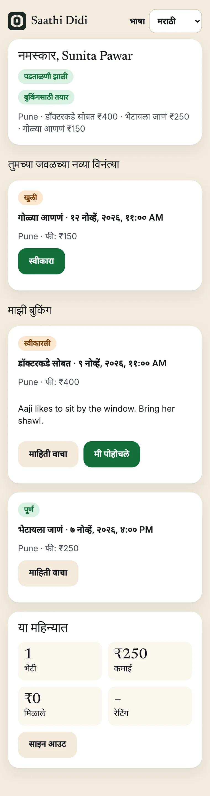
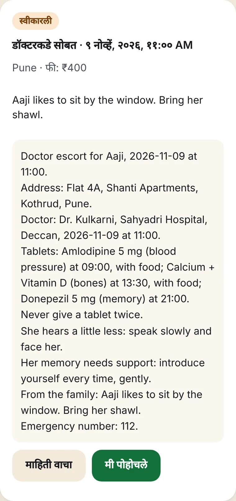
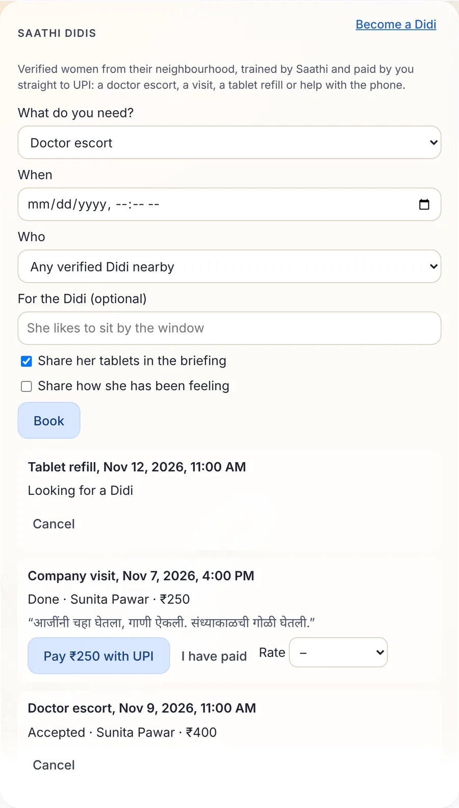
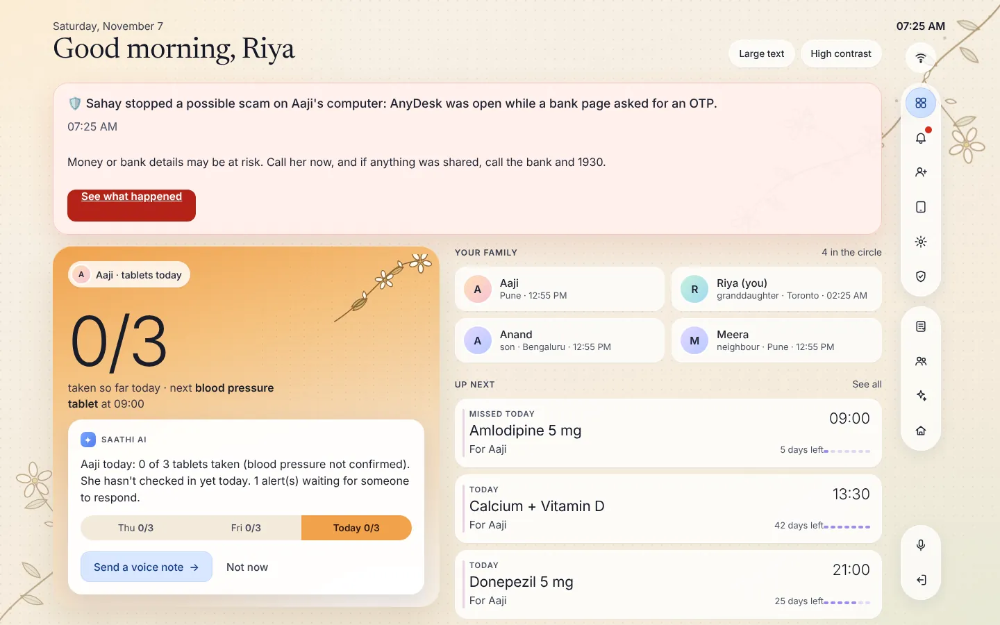
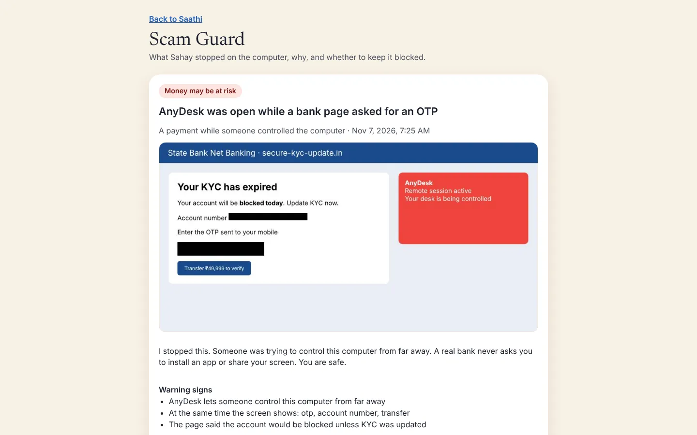
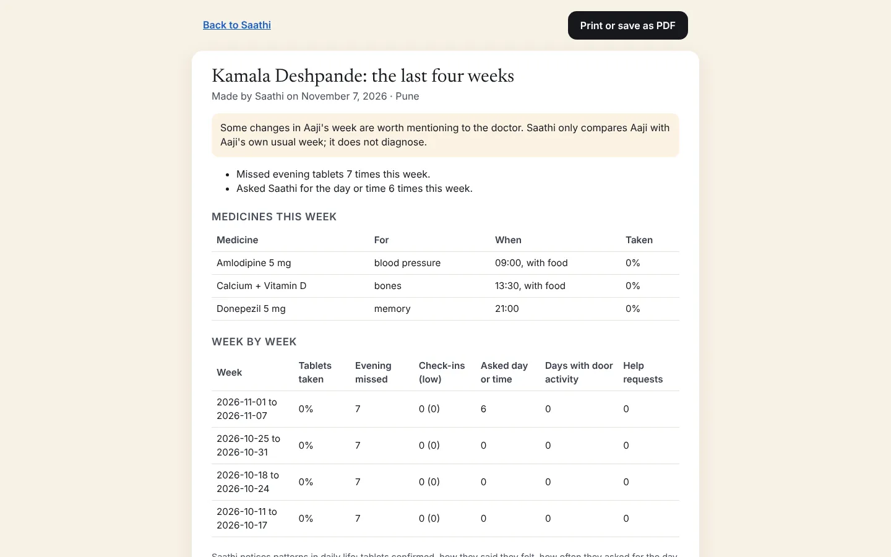

# Saathi on Google

**A companion for India's elders, and paid care work for the women who already look after them.**

Saathi keeps an elder safe, independent and close to family, in their own language. It reminds her about her tablets and stops double doses. It asks how she is and tells the family gently when she sounds low. It translates family messages both ways, and it tells her who is at the door. It warns her about scam calls, and it escalates a call for help until someone is on the way. **Saathi Didis** turns the care that neighbourhood women already give into paid, trusted work: families book a verified Didi for a doctor escort, a visit, a tablet refill or help with the phone, and pay her straight to her UPI.

Built on **Gemini, Google Cloud and Firebase**. The story, every feature, the plan and the buildathon answers are in **[MASTER.md](MASTER.md)**.

| | | |
|---|---|---|
| <br><sub>The Didi app, in her language</sub> | <br><sub>A briefing with only what the family shares</sub> | <br><sub>Book, read her note, pay with UPI</sub> |
| <br><sub>The family app</sub> | <br><sub>Scam Guard</sub> | <br><sub>Saathi Insight's doctor report</sub> |

## Google, piece by piece

| Google | What it does in Saathi | Code |
|---|---|---|
| **Gemini** (Gemini API or **Vertex AI**) | Understands the elder in Marathi, Hindi or English and picks Saathi's tools; runs the family assistant; writes Didi briefings in the Didi's language | `src/agent/llm.js` |
| **Cloud Run** | Runs everything: the family, elder and Didi apps, MCP, webhooks, reminders and escalations | `scripts/deploy-cloud-run.js`, `Dockerfile` |
| **Firestore** | Every household, booking and Didi, with transactional updates | `src/google/firestore.js` |
| **Cloud Translation** | Messages, stories, check-ins and Didi visit notes, both ways | `src/google/language.js` |
| **Natural Language** | How the elder sounded in a check-in | `src/google/language.js` |
| **Text-to-Speech** | Real Marathi, Hindi, Tamil and Bengali voices, slower for hearing loss | `src/google/language.js` |
| **Pub/Sub** | The stream of care events (help, doses, Didi arrivals) | `src/google/platform.js` |
| **Cloud Storage** | Voice notes and Family Voice reminders, with short-lived signed links | `src/google/platform.js` |
| **Google Maps** (Routes API) | Matches families with Didis by real travel time | `src/google/maps.js`, `src/didis/didis.js` |
| **Firebase Authentication** | Email and password accounts | `src/google/firebaseAuth.js` |
| **Google sign-in** and the **Gmail API** | One-tap sign-in; invites and alerts from the family's own Gmail | `src/accounts/google.js` |
| **Secret Manager** and **Cloud Logging** | Keys outside the code; structured logs and metrics | `scripts/deploy-cloud-run.js`, `src/google/metrics.js` |

Every capability also has an offline version (`src/local/`), so the tests and the demo run without a cloud account.

## Try it (2 minutes, no cloud account)

```sh
git clone https://github.com/akshatinnovate-png/saathi-google && cd saathi-google
npm install
npm run demo
```

Open http://localhost:8787 and sign in as `riya@saathi.demo` with the password `saathi-demo-2026`. Aaji's screen is at `/alexa.html` and the Didi app is at `/didi.html`.

To use Gemini, get a free key at https://aistudio.google.com/apikey and run `npm run setup` (the key is typed into the setup prompt, never into code).

## Deploy to Google Cloud (one command)

1. Install the gcloud CLI and run `gcloud auth login`.
2. In the Cloud Console, add these in **Security → Secret Manager**: `SAATHI_SESSION_SECRET` (32+ random characters), and if you use them, `SAATHI_GOOGLE_CLIENT_SECRET`, `SAATHI_MAPS_API_KEY`, `SAATHI_FIREBASE_API_KEY`, `SAATHI_DIDI_PARTNER_CODES` and `SAATHI_RING_WEBHOOK_SECRET`.
3. Run:

```sh
npm run deploy -- --project=YOUR_PROJECT --region=asia-south1
```

The script enables the APIs and creates the Firestore database, a private media bucket, the Pub/Sub topic and a service account with only the roles Saathi needs. It then deploys to Cloud Run with Gemini on Vertex AI. Add `--dry-run` to see every command first. When it prints the service address, set `SAATHI_PUBLIC_URL` to it and run the command once more.

## Saathi Didis

- **For her:** she signs up at `/didi.html` in Marathi, Hindi or English, sets her own fee for each kind of help, and adds her UPI ID. A partner code from her self-help group or NGO verifies her, and three short lessons (helping someone stand, missed doses, scam calls) make her ready. Then she accepts requests near her, reads a briefing in her language, checks in, leaves a note and sees what she earned.
- **For the family:** the care view lists ready Didis by travel time, rating and fee. The family books one and hears when she accepts, arrives and leaves, with her note in English. They pay her with one UPI tap and rate the visit.
- **For the elder:** she hears who is coming and when, and is told when the Didi arrives.
- **Safety:** a Didi sees only what the family chose to share. Her sign-in key lives in an HttpOnly cookie, and only its hash is stored. Saathi never takes a cut of her fee.

## Everything else Saathi does

Tablets by colour and purpose, with no double doses. Proactive reminders. Family Voice. Check-ins with gentle nudges. Messages translated both ways. A memory book and Living Legacy. The house map ("where are my glasses?"). The doorbell (Ring, or any doorbell through a private link). The help escalation. Scam Shield, Scam Guard (with Sahay on Windows and Android) and the Scam Shield Network. Saathi Insight and the doctor report. The medical ID card. Saathi Calls. Device pairing with a 6-digit code. Passkeys, two-step sign-in, end-to-end encrypted private messages, and the HMAC-chained audit log. All of it is described in [MASTER.md](MASTER.md), section 15.

## Tests and checks

```sh
npm test          # 190+ tests, offline
npm run coverage  # at least 90% of lines and 80% of branches
npm run lint
npm run a11y      # axe-core across every screen, including the Didi app
npm run eval      # multilingual safety and routing evals
```

## More

- [docs/ARCHITECTURE.md](docs/ARCHITECTURE.md): how the pieces fit, with diagrams
- [SECURITY.md](SECURITY.md), [PRIVACY.md](PRIVACY.md), [docs/THREAT_MODEL.md](docs/THREAT_MODEL.md)
- [CHANGELOG.md](CHANGELOG.md)

MIT licensed.
