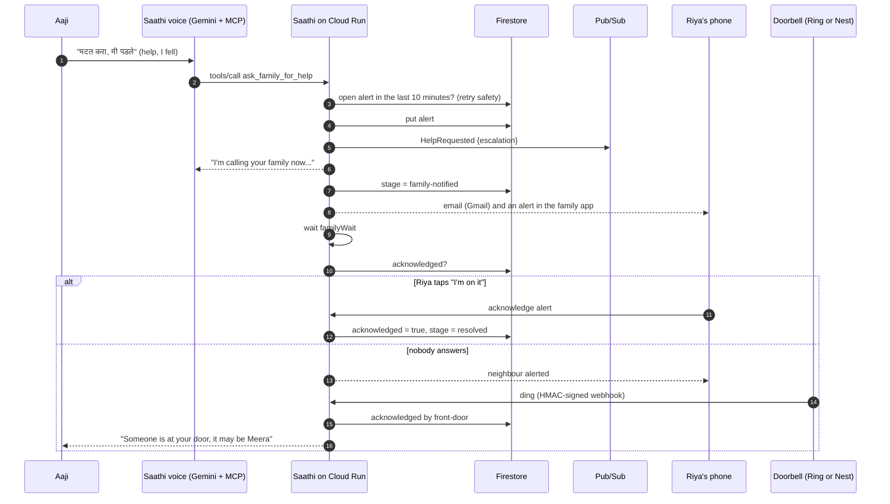
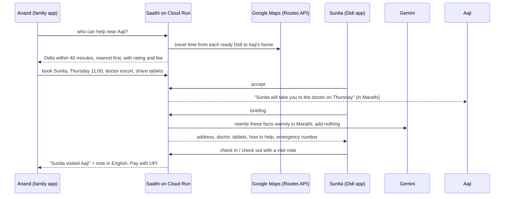
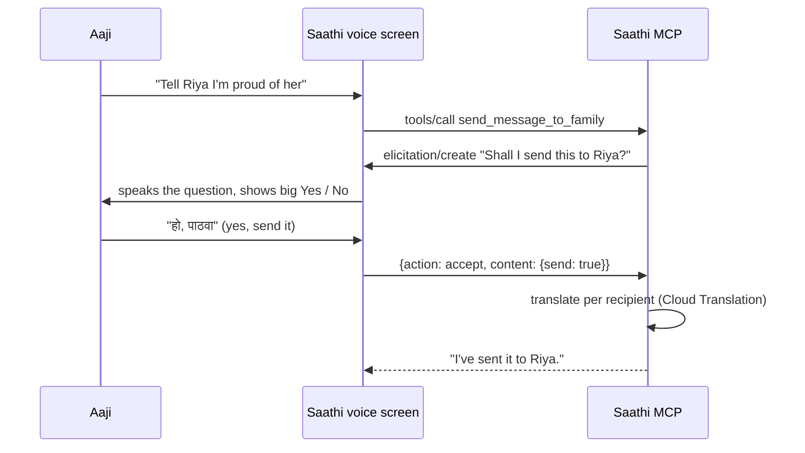

# Saathi architecture (Google)

## Layers

```
src/
  domain/        what Saathi does: orientation, tablets, check-ins, escalation, messages, stories, doorbell signals
  didis/         Saathi Didis: sign-up, lessons, matching, bookings, briefings, visits, UPI payment, earnings
  mcp/           the MCP surface: tools, resources, templates, prompts, subscriptions, logging
  auth/          per-tool scopes for household device keys and static tokens
  http/          Express: Streamable HTTP, doorbell webhook, family, Didi and voice-screen APIs, SSE
  escalation/    one escalation flow definition and the interpreter that runs it
  google/        an adapter per Google capability: Gemini, Firestore, Translation, Natural Language,
                 Text-to-Speech, Pub/Sub, Cloud Storage, Maps, Firebase Authentication, Cloud Logging
  local/         the same capabilities offline, so the tests and the demo need no cloud account
  agent/         Saathi's voice and family assistants: MCP client + Gemini, or an offline planner
  ring/          webhook signing and verification, and the simulated doorbell
core/            the Rust permission rules, compiled to WebAssembly and proven with Kani and TLA+
evals/           multilingual safety and routing evals
```

The domain never imports a cloud SDK. `src/services.js` picks an adapter for each capability from config flags, so every Google service can be switched on independently and the tests run fully offline.

## A fall, end to end



The escalation runs inside the service, which keeps one instance warm with CPU always allocated (`--min-instances=1 --no-cpu-throttling`), and every step is written to Firestore, so the family app shows exactly where it is.

## A Didi visit, end to end



## Elicitation: nothing leaves the house by accident



## Why each Google service is there

| Service | Job | Why this and not something simpler |
|---|---|---|
| Cloud Run | The whole service: web apps, MCP, webhooks, sweeps | One container, scales out, HTTPS by default; one warm instance keeps reminders and escalations running |
| Gemini (API or Vertex AI) | Understanding Aaji, planning tool calls, the family assistant, Didi briefings | Function calling over the same MCP tools; Hindi and Marathi understood natively |
| Firestore | All household and Didi state | Serverless, transactional updates, Google-managed encryption |
| Cloud Translation | Every message, story, check-in and visit note | Auto-detects Marathi vs Hindi |
| Natural Language | Check-in sentiment | Languages it does not cover go through Translation first |
| Text-to-Speech | Replies and reminders read aloud | Real Marathi, Hindi, Tamil and Bengali voices; slower speech for hearing loss |
| Pub/Sub | The care-event stream | Every event (help, doses, Didi arrivals) can feed analytics or other services without touching Saathi |
| Cloud Storage | Voice notes, Family Voice, narrations | Private bucket, short-lived V4 signed links |
| Maps (Routes API) | Matching Didis by real travel time | "Nearest" means 12 minutes by scooter, not the same city name |
| Firebase Authentication | Email and password accounts | Managed password storage and verification emails; Google sign-in works alongside |
| Secret Manager | Keys and secrets | Never in code or in plain environment variables |
| Cloud Logging | Structured logs and metrics | Log-based metrics and alerts for failed escalations |

## What stays on the family's own computer

Sahay (Windows and Android) watches for scams and helps with technology on the elder's own device, and reports to Saathi only through a direct connection from that computer. The Windows install keeps its key in the computer's TPM through the Rust key broker; the hosted Cloud Run service relies on Firestore's encryption and Secret Manager instead.
